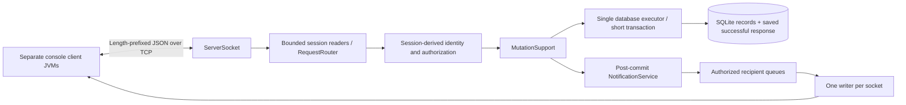

# Architecture — completed Member 2 stage

Academic demonstration — no real emergency dispatch.

Confirmed supplied requirements are Java-only network communication and real-time exchange. The original lecturer assignment document was not supplied. Java 21, Maven, framed TCP JSON, SQLite and console menus are the group's implementation choices. The original student brief remains in ../requirements/project-brief.txt; no new threading mandate was discovered.

Default 32 sessions, configurable 1–200; a semaphore bounds reader submissions. Each connection has one reader and one writer with a 100-frame nonblocking outgoing queue. Full queues close that session, and a five-second writer watchdog closes blocked writers. Frame payloads are capped at 65,536 bytes. Public list/detail pages are bounded to keep responses within that cap. JSON and socket reads never depend on the console input loop.

The existing registry monitor serializes identity changes with protected request routing. Business SQL runs exclusively on the database executor. Session-derived presence reads a concurrent map and isClosed without taking the registry monitor from a database callback; acquiring it there would deadlock while a router waits for the executor. Never recursively call Database.call/transaction inside database work.

MutationSupport recursively sorts object keys, including the outer type/payload object, before SHA-256 hashing. It scopes deduplication to user/request ID, executes business SQL and saves the success envelope in one transaction, and returns a replay flag. All Member 2 business mutations use it. Login/registration/logout do not replay stored business responses.

After commit, NotificationService reads the committed projection and enqueues authorized events. Replay suppresses repeated events. Notification errors are caught after commit and cannot turn committed changes into rollbacks. Delivery remains best effort; there is no persistent offline event queue or exactly-once network guarantee.

Incident creation saves its public timeline atomically. Operator priority/rejection and assignment/cancellation require explicit expected revisions. Assignment derives the service and responder identity from the stored team, verifies ONLINE + AVAILABLE, checks active conflicts, creates OFFERED, reserves BUSY, and activates/touches the incident atomically. Both partial unique indexes remain authoritative safeguards. Cancellation permits OFFERED/ACCEPTED only, stores its reason as a private internal note, releases AVAILABLE, and leaves the incident ACTIVE for reassignment.

Public detail DTOs contain no private note/actor credential/contact fields. Responders list offers only by their session-derived team. Operator filters do not weaken ownership checks. Private notes remain stored server-side; the Member 2 public timeline projection does not expose them to any role.

Client PendingActions retains the original request and future when ten seconds elapse. Menu 90 shows pending/late-completed outcomes for the current user and can resend the unchanged request ID. The map is bounded to 20 and isolates records by user ID. This is an in-memory, same-client-session mechanism; durable drafts and reconnect reconciliation remain Member 3 work.

No automatic heartbeat or reconnection is implemented. The snapshot's blocking reader behavior is retained; connection count and write queues remain bounded. Disconnecting a BUSY responder does not release its stored reservation. Tests verify persistence and offline presence after restart, but full snapshot-based responder recovery is still Member 3's responsibility.

Server shutdown closes listener/sessions and joins network workers before closing the database; the shutdown hook closes both server and DB. Client shutdown closes its socket, fails pending futures and interrupts/joins its network threads. Expected disconnects/malformed frames do not dump message contents to logs.
