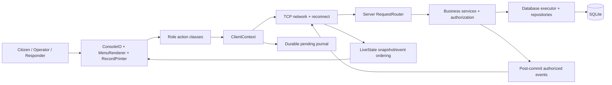

# Architecture

Frames remain four-byte big-endian length plus bounded UTF-8 JSON. Human-readable cards are a client presentation change; structured wire DTOs remain independently testable. Each session has one reader and a bounded writer queue; watchdogs isolate blocked clients. All business changes and successful retry responses commit atomically on one SQLite executor.

Heartbeat runs every 15 seconds, inactivity is 45 seconds and blocked writes have a deadline. Reconnect backs off with jitter (1/2/4/8/up to 15 seconds), clears authentication and requires explicit login. No passwords are saved. Reservations remain BUSY during disconnect and are reconciled against active assignments on startup.

Login subscribes before capturing a frozen authorized snapshot. The client buffers sequenced events, swaps a complete snapshot, then applies only newer revisions in the same server epoch. Snapshots have bounded pages/lease; overflow or incomplete data requires a fresh synchronization. History is queried separately.

Only the operator receives new-report notifications. Citizens see their own reports; responders see their own team and assignments. Public projections omit private notes. All UI simplification preserves those authorization boundaries.
