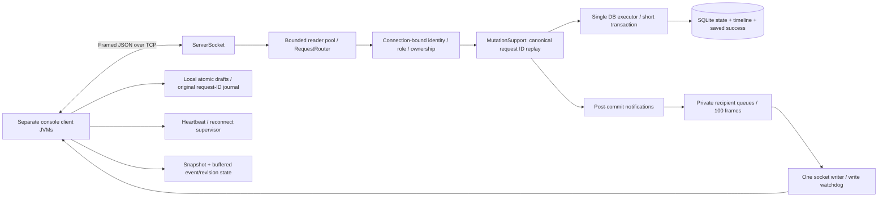

# Final architecture and recovery

Academic demonstration — no real emergency dispatch.



The server accepts 32 simultaneous sessions by default (configurable 1–200) using bounded platform threads. A semaphore bounds submitted readers. Each session has one writer, a 100-frame queue and five-second write deadline. Idle sessions close after 45 seconds without a complete inbound frame, including partial-frame stalls. Client PING/PONG runs every 15 seconds independently of menus; client inbound inactivity/write watchdogs also close lost/stalled sockets.

Every protected action derives actor/team identity from the authenticated session. The session registry monitor serializes identity changes, business routing, snapshot creation and event sequence allocation. SQL callbacks run on one database executor and must never recursively call Database or acquire the registry monitor. Presence reads use a concurrent map/closed flag. PBKDF2 is outside the DB executor and remains 600,000 iterations with salted constant-time verification.

MutationSupport checks user/request ID and canonical SHA-256, saves a successful envelope atomically with business state and timeline, and returns whether it replayed. Request type and recursively sorted object keys are hashed deterministically; arrays/numeric representation retain meaning. Response and event delivery happen after JDBC commit. A failed notification cannot undo the commit; replays suppress repeated notifications. Delivery is best effort, not exactly-once TCP or a persistent event journal.

Assignment offers reserve ONLINE/AVAILABLE teams as BUSY and activate/touch the incident in one transaction. Responder transitions check assignment/incident/team revisions and stored ownership. Terminal decline/completion releases the team; cancellation permits OFFERED/ACCEPTED only. Incident closure atomically requires ACTIVE, at least one COMPLETED assignment, and no nonterminal assignments. Startup reconciles BUSY from persisted active assignments before accepting clients.

## Snapshot and event ordering

```mermaid
sequenceDiagram
 participant C as Client reader + main
 participant S as Server registry/router
 participant D as DB executor
 C->>S: LOGIN (credentials are never persisted)
 S->>S: Bind identity / subscribe authenticated socket
 S-->>C: Login result
 C->>S: GET_SNAPSHOT offset=0
 S->>D: Freeze authorized active state
 D-->>S: Immutable records + epoch/watermark
 S-->>C: Bounded snapshot page / socket-owned token
 S-->>C: New events with epoch + sequence
 Note over C: Buffer events during pagination
 C->>S: Remaining token/offset pages
 S-->>C: Same frozen epoch + watermark
 Note over C: Atomically install snapshot; apply only buffered sequence > watermark; ignore older entity revisions
```

Snapshots contain only authorized active incidents/assignments and permitted team projections, not private notes. They are frozen per socket under the routing monitor, paged at five records, limited to 5,000 active records and expire after 30 seconds. Logout/disconnect/lease cleanup releases the freeze. Full historical queries are separately paginated. Scope/lease failures require a fresh synchronization.

Business events carry optional envelope epoch/sequence metadata. Presence events use the same ordering even when a team's database revision is unchanged. LiveState buffers up to 1,000 events, filters pre-snapshot/old-epoch events, swaps the snapshot atomically and ignores older entity revisions. An overflow fails synchronization and requests a new snapshot rather than silently dropping state. Entity caches are capped at 5,000 each.

## Client recovery and local data

ReconnectingClient supervises sockets independently of console input. Backoff bases are 1/2/4/8/15 seconds, jittered and capped at 15. Reconnection clears authentication; no password is cached or auto-replayed. Login synchronizes before returning to role controls. Old-generation socket responses/events cannot authenticate a new connection or overwrite a new server epoch.

LocalJournal writes original business envelopes before sending, merges pending IDs under short file locks and atomically replaces user/server-scoped JSON files. It never accepts LOGIN/registration/password records. Completed input fields are saved as an unsent report draft. PendingActions removes a journal entry only after a definite response, retains uncertain outcomes, and resends the exact original envelope through menu 90 after login. The journal stores fictional reports/private notes locally without encryption; use the same trusted OS account and preserve it when reconciling uncertain requests.

ConsoleIO serializes output and redraws the prompt without holding its lock during input. Times display in Asia/Colombo. Ordinary terminal echo can split partially typed text; physical keyboard behavior remains a manual check. Data/logic stays Java-only; PowerShell scripts only build/run/package it.

## Shutdown and verification boundaries

Server shutdown closes listener/sessions, cooperatively waits for readers/writers and watchdogs, then closes SQLite. Client shutdown stops reconnect/heartbeat tasks, closes the socket and joins network workers. Tests inject short timers; production defaults remain 15s/45s/5s. The actual process smoke exercises reconnect, restored reservations, complete service progress, closure, history and draft restart. Load timing uses real loopback TCP with server and headless clients in one JVM and timestamps immediately after commit and after event decoding. It does not measure physical screen repaint or separate-laptop network latency.
