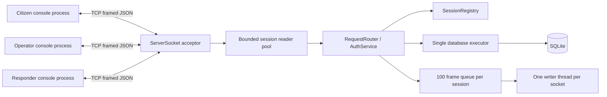

# Architecture — Member 1 foundation

University of Ruhuna, Faculty of Engineering. EC5205 Operating Systems & Network Programming.
Emergency Help Network for Police, Ambulance and Fire & Rescue Services.
Academic demonstration — no real emergency dispatch.

Confirmed requirements from the supplied student brief: network communication and real-time exchange; Java only. Java 21, Maven, TCP/JSON, SQLite and console menus are the group's implementation choices. The original lecturer assignment document was not supplied. Sibling `NetProg25th/src/NP25` socket examples and `src/Threads/ThreadHandler.java` were inspected read-only; they demonstrate sockets and platform Thread/Runnable, without an additional explicit threading mandate. No AGENTS.md was found along the target folder's parent chain. Target initially empty; no Git metadata. Original instructions are preserved in docs/requirements/project-brief.txt.

Default maximum: 32 connections, configurable 1–200. A semaphore is acquired before reader submission, so the executor's internal queue cannot accumulate unlimited session jobs. Excess sockets close immediately. One acceptor, up to 32 reader platform threads and 32 writer platform threads, one write watchdog, one database thread. No virtual threads, REST or direct client database access.

The reader decodes frames and calls the router sequentially per socket. Only the writer writes socket bytes. Producers use a nonblocking 100-frame queue: overflow closes that session. A write exceeding five seconds causes the watchdog to close the socket, unblocking the writer. Other sessions keep their own queues and writers. Each socket currently has a 60-second read timeout, a foundation resource guard; Member 3 replaces/completes this with 15-second heartbeat and 45-second inactivity handling. Keep the demo active with Ping before that timeout.

Auth hashes run on bounded session threads, outside the database executor. SQLite runs exclusively on one executor thread. Repositories receive its Connection; callers never retain it. Database.transaction commits before returning. Never call Database.call/transaction recursively from database work: use the supplied Connection instead.

Registry identity replacement and protected routing synchronize on the same registry lock. This prevents a replaced socket from issuing another protected operation after replacement. Login hashing occurs outside the lock. Only the authenticated socket supplies identity. Session replacement sends SESSION_REPLACED and closes the old connection. Cleanup removes identity only if the registry still maps to that exact session. Online presence is derived, never saved.

MutationSupport executes a business callback and saves its success envelope in one transaction. Callbacks must use conditional SQL such as `UPDATE teams SET availability=?, revision=revision+1 WHERE id=? AND revision=?`; pass update count to requireUpdated. Distinguish missing entity and other business failures before the update. After execute returns, send the committed response, then notify recipients only when replayed=false. This foundation does not implement later incident operations or persistent offline events. The server is authoritative; notifications never substitute for database state.

The client has an input thread (main), socket reader, socket writer, bounded outbound queue, and request ID → future map. Events are handled immediately even while input is pending. ConsoleIO locks printing, starts event lines cleanly and redraws the current prompt. Ordinary terminal echo may split a partially typed line; a manual terminal usability check remains for the group. Credentials never enter application logs. Java immutable password Strings cannot be reliably wiped; password char arrays/specs are cleared where available.

Shutdown: server closes listener, joins acceptor, closes sessions, interrupts and awaits reader/watchdog pools; each reader joins its writer. Main closes SQLite after server termination. Client closes socket, fails pending futures and interrupts/joins network threads. Tests close resources explicitly. Console processes remain separate; test threads are a test harness, not the deployed UI.
