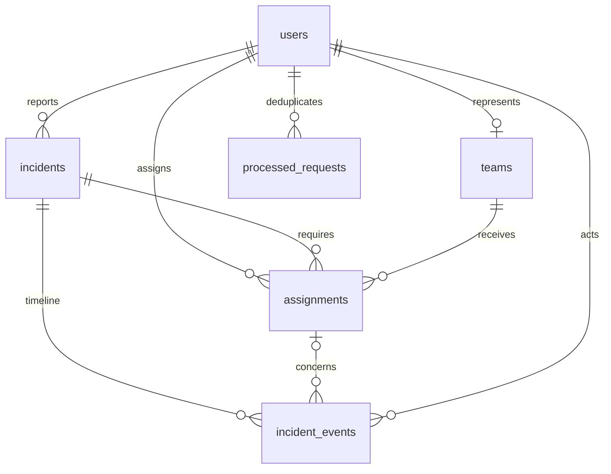

# Database model

V001__foundation.sql is applied once in a transaction and recorded in schema_migrations. Add V002 and extend the migration runner explicitly for the next schema change; never edit an applied migration. Foreign keys ON, busy timeout 5000 ms, WAL. Prepared statements bind all external values. UUIDs and UTC ISO-8601 strings originate on the server; display dates in Asia/Colombo.

| Table | Data and integrity |
|---|---|
| users | UUID PK; exact, case-sensitive unique Unicode username; display name; 32-byte derived password hash; random salt ≥16 bytes; stored iteration count; role constraint; optional synthetic contact; creation time |
| teams | UUID PK; unique responder_user_id FK; name; service enum; availability enum; nonnegative revision. Presence is not stored. |
| incidents | Owner FK; category; bounded address/description; paired/ranged coordinates; priority/state enums; public resolution; created/updated/closed timestamps; revision |
| assignments | Incident/team/operator FKs; service/state enums; bounded optional reason; created/updated times; revision |
| incident_events | Incident, optional assignment, actor FKs; event type; public message; separate private internal note; timestamp |
| processed_requests | User/request ID composite PK; canonical request hash; original success envelope JSON; timestamp |

Partial unique indexes cover assignments in OFFERED, ACCEPTED, EN_ROUTE and ARRIVED: one active assignment per team and one per incident/service. Indexes support citizen history, incident state/priority, team service/availability, assignment history and timelines. State transitions, actor role consistency and cross-table service equality are enforced by the Member 2/3 business services; database enum checks alone do not enforce those workflows.

Users, teams, incidents, assignments, timeline and processed-request access are implemented for Member 2. Incident/report/offer/cancellation/rejection services are exposed with public DTOs. Acceptance/progress/closure are implemented in Member 3. Startup presence is OFFLINE until login. Startup reconciliation now derives BUSY from active assignments without releasing disconnected reservations.

Seed creates operator, citizen1, citizen2, police1, ambulance1, fire1, fire2 and four corresponding teams. Every default password: DemoPass123! (fictional local/LAN demo only). Re-running seed adds missing accounts/teams, never overwrites existing hashes or availability. It does not create incidents.

## Member 2 transaction usage

No columns/tables changed, so V001 remains unchanged and no artificial V002 migration was introduced. New mutations use the existing full schema.

- CREATE_INCIDENT writes incidents + incident_events + processed_requests in one transaction.
- ASSIGN_TEAM writes OFFERED, increments team revision and sets BUSY, sets/touches incident ACTIVE and increments its revision, and writes the public event + processed response atomically.
- CANCEL_ASSIGNMENT checks assignment/incident/team revisions, updates only OFFERED/ACCEPTED to CANCELLED, releases AVAILABLE and increments team/incident revisions, stores the private reason in internal_note, and saves the processed response atomically.
- SET_TEAM_AVAILABILITY permits AVAILABLE/UNAVAILABLE only without active assignments. REJECT_INCIDENT checks REPORTED and no assignment history. SET_PRIORITY rejects terminal incidents.
- Presence is session-derived. A disconnected team with an offer stays BUSY. Public DTOs do not serialize internal_note/reason columns.

Fresh demo databases are used in this checkout. The original snapshot's noncanonical processed-request fingerprints are not migrated; do not silently import an old snapshot database and assume replay compatibility. Keep the original database backed up and reconcile any real pending test requests before changing implementations.

## Member 3 completion

The full V001 schema already supports final states/history/recovery; no schema edits or artificial migration were needed. Responder transitions, reservation release, incident revision/timeline and processed response commit in one transaction. Closure checks all assignment states and at least one COMPLETED before setting CLOSED/public resolution/closed_at.

Startup reconciles teams to BUSY wherever an active assignment exists and releases only orphaned BUSY rows with no active assignments. Presence remains entirely session-derived. Progress/decline notes stay in assignments.reason and incident_events.internal_note, with public messages separate. Own timelines return only notes written by that responder; operator detail notes remain operator-only. Snapshots contain public active projections, never private notes.

Local client JSON journals are separate from the authoritative SQLite DB. They contain only fictional draft/business request input, keyed by server endpoint/user UUID, with atomic writes and short file locks. They never replace server authorization or store passwords. The source/runnable packages exclude local journals/databases.
