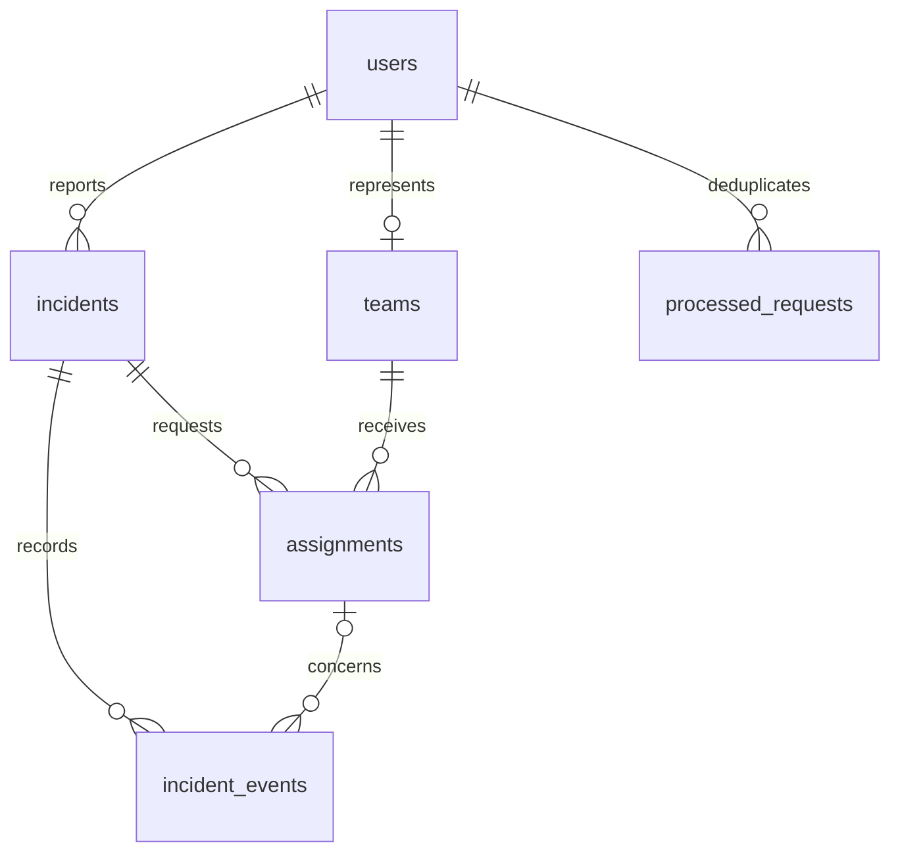

# Persistence and short references

V001 defines users, teams, incidents, assignments, incident_events, processed_requests and their integrity/index rules. V001 is unchanged. V002 adds a singleton reference_sequence starting at 10000.

ReferenceIds.next(Connection) atomically increments the durable sequence and returns a five-digit string. It runs on the same DB executor/transaction as the new record. Accounts, teams, incidents, assignments and timeline events all use the same sequence, so references do not collide across these entities. Aborted mutations roll back their allocation. Existing rows and processed responses are never renumbered. The fresh demo database in this edition contains numeric references only. Range 10000-99999 permits 90,000 global records; exhausted allocation returns a clear validation error rather than wrapping/reusing an ID.

Sequential references are convenience identifiers, not passwords or access tokens. Ownership/role authorization is checked on every request. Idempotency request IDs and snapshot/epoch tokens remain internal UUIDs; the UI chooses pending actions by list number, without displaying those tokens.

The client always sends null legacy coordinate fields and never asks/displays them. Optional V001 columns remain solely for schema/protocol compatibility; this avoids destructive migration of an applied database. Location is an address/landmark. Private notes stay separate from public timeline messages.

Partial unique indexes forbid an active assignment for the same team or incident/service. Foreign keys, WAL and expected-revision updates remain enabled. Terminal assignments release availability transactionally. Startup derives BUSY from saved active assignments; it does not free a disconnected team.
