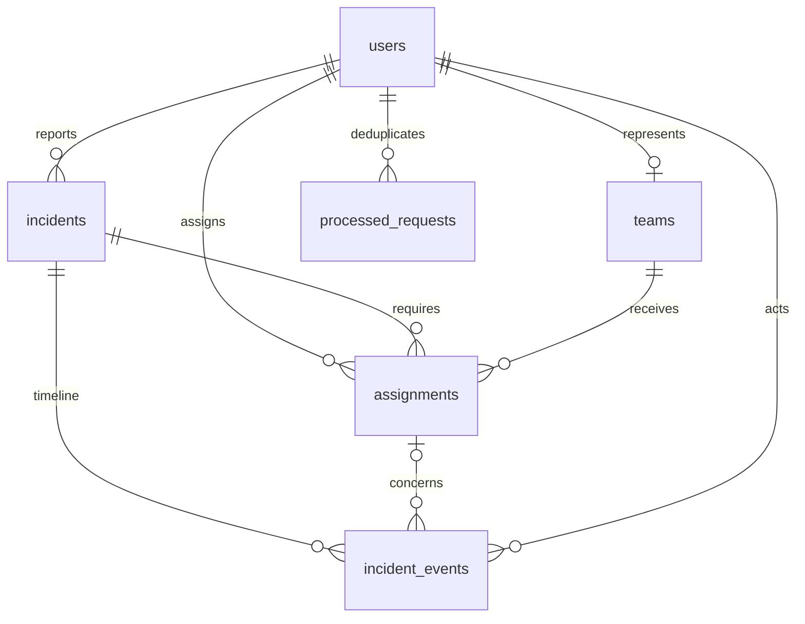

# Database model

V001__foundation.sql is applied once in a transaction and recorded in schema_migrations. Add V002 and extend the migration runner explicitly for the next schema change; never edit an applied migration. Foreign keys ON, busy timeout 5000 ms, WAL. Prepared statements bind all external values. UUIDs and UTC ISO-8601 strings originate on the server; display dates in Asia/Colombo.

| Table | Data and integrity |
|---|---|
| users | UUID PK; exact, case-sensitive unique Unicode username; display name; 32-byte derived password hash; random salt ≥16 bytes; stored iteration count; role constraint; optional synthetic contact; creation time |
| teams | UUID PK; unique responder_user_id FK; name; service enum; availability enum; nonnegative revision. Presence is not stored. |
| incidents | Owner FK; category; bounded address/description; paired/ranged coordinates; priority/state enums; public resolution; created/updated/closed timestamps; revision |
| assignments | Incident/team/operator FKs; service/state enums; bounded optional reason; created/updated times; revision |
| incident_events | Incident, optional assignment, actor FKs; event type; public message; separate private internal note; timestamp |
| processed_requests | User/request ID composite PK; canonical request hash; original success envelope JSON; timestamp |

Partial unique indexes cover assignments in OFFERED, ACCEPTED, EN_ROUTE and ARRIVED: one active assignment per team and one per incident/service. Indexes support citizen history, incident state/priority, team service/availability, assignment history and timelines. State transitions, actor role consistency and cross-table service equality still need business validation in Members 2/3; database enum checks alone do not enforce those workflows.

Only users/teams repositories are implemented at this stage. Schema for the entire application is ready, but no incident or assignment service is exposed. Startup presence is OFFLINE until login. Future startup reconciliation must derive BUSY from active assignments without releasing disconnected reservations (Member 3).

Seed creates operator, citizen1, citizen2, police1, ambulance1, fire1, fire2 and four corresponding teams. Every default password: DemoPass123! (fictional local/LAN demo only). Re-running seed adds missing accounts/teams, never overwrites existing hashes or availability. It does not create incidents.
