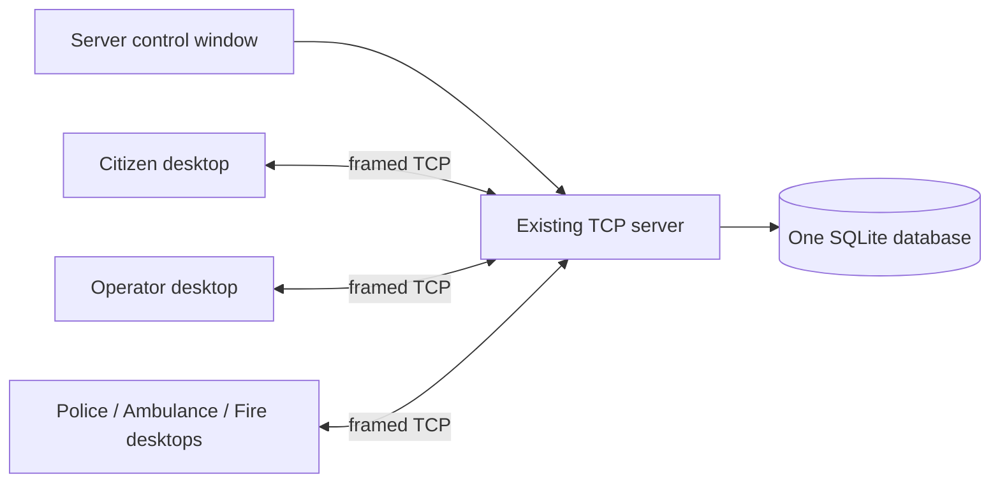

# Desktop UI design

The GUI is a small Swing presentation layer on the existing framed TCP application. The server remains the authority for authentication, authorized data, revision checks and state transitions. There is no browser, web backend or new UI library dependency.

| Part | Responsibility |
|---|---|
| DesktopTheme | Navy/blue palette, fonts, readable tables, action buttons and safe message wrapping |
| ServerDesktop | Background server start/stop, Wi-Fi address selection, copy IP, session/report counts |
| ClientDesktop | Window lifecycle, async task handling, login/reconnect routing and button handlers |
| DesktopSession | Existing transport, authorized snapshots, fresh revisions, pending journals and role actions |
| SignInPanel | Endpoint check and masked login; endpoint settings contain no credentials |
| ClientDashboard | Four role-specific work areas, live notifications and selection-based actions |
| RecordTable | Immutable row data, sort-aware reference selection, non-editable cells |
| ReportPanel | Three fields, draft restoration/autosave and visible submit/save buttons |
| DetailsDialog | Public or own service timelines; operator-only notes only when authorized by the server |

Network, seed and database work runs on background workers. Swing widgets update on the event-dispatch thread. Events mark the dashboard dirty and a timer coalesces refreshes, rather than opening a dialog per event. Controls use current server revisions; stale actions remain subject to server validation. An uncertain mutation blocks a new mutation until the original saved request is reconciled.

Logout, disconnect or replacement login clears the authenticated dashboard and closes owned details windows, so a subsequent user does not inherit the previous user's private screen. Closed/declined/cancelled responder records appear under History; active offers and work remain under My assignments.

The Windows CMD/VBS helpers launch javaw without a persistent terminal. Portable Windows x64 packages use a jlink runtime containing java.desktop and preserve the runtime's legal notices. Source builds use the existing Maven reactor and a Java 21 JDK.

Official module reference: [Java 21 java.desktop](https://docs.oracle.com/en/java/javase/21/docs/api/java.desktop/module-summary.html).
