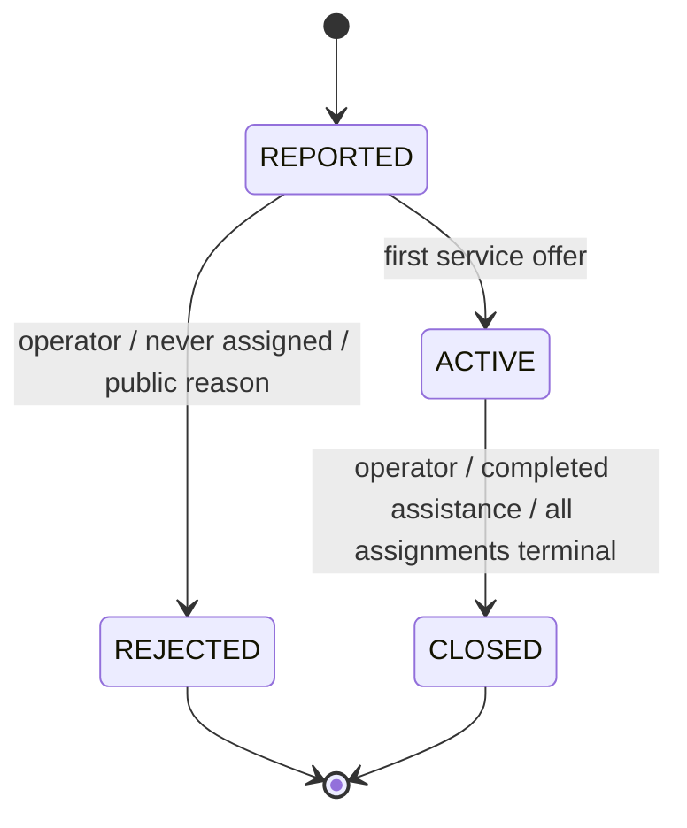
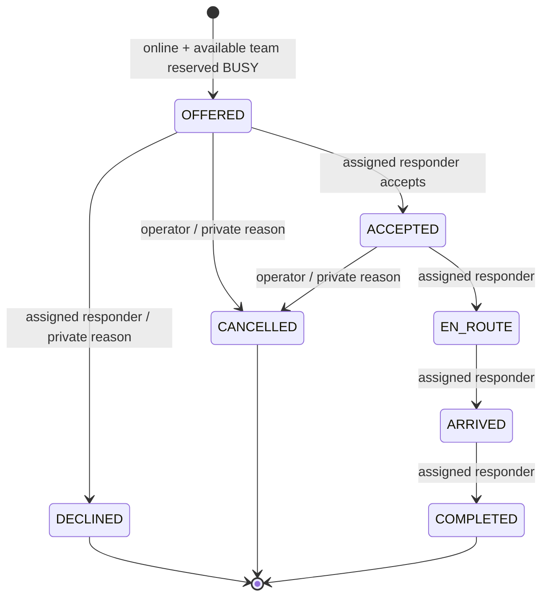

# State rules

ACTIVE remains visible when every offer is declined or cancelled. Each service has its own assignment state; one service arriving never means all services arrived.

Terminal assignments release AVAILABLE. EN_ROUTE/ARRIVED cannot be cancelled. Skips, backward updates, duplicate new-ID transitions, stale revisions and unrelated responders fail. Exact same-ID retries return their original successful response. One active assignment per team and per incident/service is also enforced by partial unique indexes.

Unassigned responders may select AVAILABLE/UNAVAILABLE. BUSY is reserved by business state, never manually selected. OFFLINE is session-derived; disconnect never releases a BUSY reservation. Startup derives reservations from saved active assignments.
